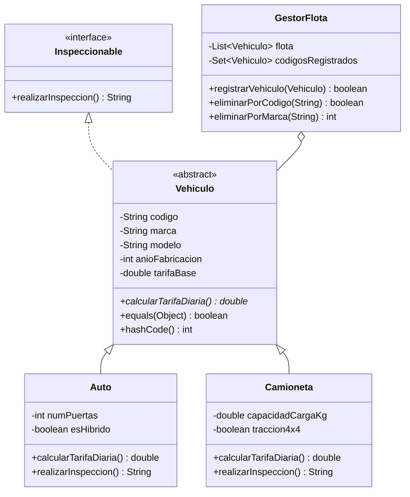
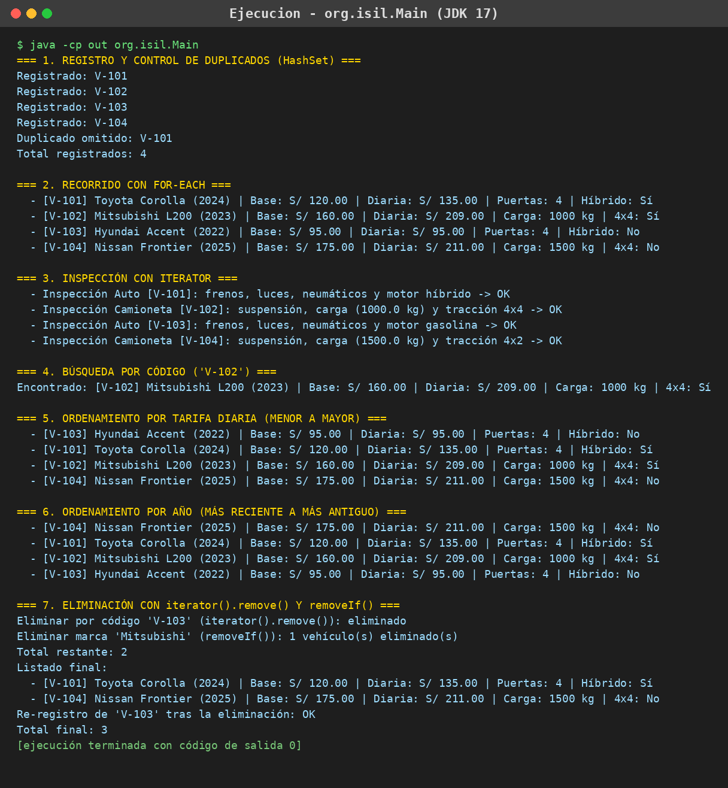

# PA4 — Sistema de Gestión de Flota Vehicular (`org.isil`)

**Curso:** Programación Orientada a Objetos (código 30626) — ISIL
**Evaluación:** PA4 — cubre las sesiones 11 a 13 del sílabo: colección de objetos, búsqueda y ordenamiento, `HashSet`, colecciones genéricas, herencia, clase abstracta, interfaz y sobrescritura de métodos.

## Descripción breve del trabajo

Proyecto Maven en Java desarrollado en IntelliJ IDEA que resuelve el caso aplicado de una **flota vehicular**. El sistema permite registrar vehículos en una colección controlando duplicados con `HashSet`, recorrerlos con `for-each` e `iterator()`, buscarlos por código y por marca, ordenarlos por tarifa diaria y por año, y eliminarlos con `iterator().remove()` y `removeIf()`. La jerarquía de clases aplica herencia simple, una clase abstracta (`Vehiculo`), una interfaz (`Inspeccionable`) y sobrescritura de métodos (`calcularTarifaDiaria()`, `realizarInspeccion()`, `toString()`, `equals()` y `hashCode()`).

## Integrantes y distribución del trabajo

| Integrante | Responsabilidad principal |
|---|---|
| Angel Fernando Reyes Moreno | Operaciones de eliminación (`iterator().remove()` y `removeIf()`), aplicación `Main` e integración, documentación del diseño en el README, acuerdos de trabajo, evidencias de compilación/ejecución y control de versiones. |
| César Augusto Maguiña Robles | Diseño de la jerarquía OO y clases del dominio (`Inspeccionable`, `Vehiculo`, `Auto`, `Camioneta`), `GestorFlota` (registro con `HashSet`, recorridos, búsquedas y ordenamientos). |

Los acuerdos de trabajo del equipo se registran en [`docs/ACUERDOS-DE-TRABAJO.md`](docs/ACUERDOS-DE-TRABAJO.md).

## Cobertura de los temas del sílabo

| Sesión | Tema | Evidencia en el código |
|---|---|---|
| S11 | Almacenamiento de objetos en colecciones | `GestorFlota.flota` (`ArrayList<Vehiculo>`) con registro de objetos. |
| S11 | Operaciones con objetos: `for-each`, `iterator()` | `listarConForEach()` y `listarConIterator()`. |
| S11 | `HashSet`, `equals()` y `hashCode()` | `codigosRegistrados` (`HashSet<Vehiculo>`) rechaza el código duplicado `v-101` frente a `V-101`. |
| S11 | Eliminar elementos con `iterator().remove()` y `removeIf()` | `eliminarPorCodigo()` y `eliminarPorMarca()`, demostrados en la sección 7 de `Main`. |
| S12 | Colecciones genéricas | `List<Vehiculo>`, `Set<Vehiculo>` y `Iterator<Vehiculo>`. |
| S12 | Tipos de datos compuestos | Las clases `Vehiculo`, `Auto` y `Camioneta` como entidades almacenadas en la colección. |
| S13 | Herencia simple, clase abstracta e interfaz | `Vehiculo` (abstracta) ← `Auto` / `Camioneta`; interfaz `Inspeccionable` implementada por `Vehiculo`. |
| S13 | Sobrescritura de métodos | `calcularTarifaDiaria()`, `realizarInspeccion()`, `toString()`, `equals()` y `hashCode()`. |

## Diseño adoptado



Decisiones técnicas y su justificación:

1. **`Vehiculo` es una clase abstracta** porque en el dominio no existe un "vehículo genérico": todo vehículo es un auto o una camioneta. La clase abstracta concentra los atributos comunes (`codigo`, `marca`, `modelo`, `anioFabricacion`, `tarifaBase`) y obliga a cada subclase a implementar `calcularTarifaDiaria()`, ya que el cálculo es distinto en cada tipo (recargo por híbrido en `Auto`; recargo por carga y por tracción 4x4 en `Camioneta`). Así se evita duplicar código y se garantiza que ninguna subclase olvide el cálculo.
2. **`Inspeccionable` es una interfaz y no un método más de la jerarquía** porque la inspección es una *capacidad* que podría aplicarse a clases fuera de la jerarquía de vehículos (por ejemplo, una máquina o un equipo de taller). Además, según la sesión 13, las interfaces permiten simular herencia múltiple: `Vehiculo` hereda de su superclase y "hereda" el contrato de `Inspeccionable`.
3. **`equals()` y `hashCode()` se basan únicamente en el `codigo`**, y el constructor lo normaliza (`trim().toUpperCase()`). Por eso el `HashSet` detecta como duplicado un objeto con código `v-101` cuando ya existe `V-101`: la unicidad del identificador es la regla de negocio, y se demuestra en la sección 1 de `Main`. También se retira del `HashSet` al eliminar, de modo que un código eliminado puede volver a registrarse (sección 7).
4. **Se usan dos colecciones con propósitos distintos**: `ArrayList` conserva el orden de inserción para los recorridos y ordenamientos (secciones 2, 5 y 6); `HashSet` aporta búsqueda/inserción rápida y garantiza unicidad (sección 1). Esta separación es deliberada: un `List` no controla duplicados y un `Set` no conserva orden.
5. **Los ordenamientos no mutan la flota**: `ordenarPorTarifaDiariaAsc()` y `ordenarPorAnioDesc()` trabajan sobre una copia y usan `Comparator.comparingDouble(...)` y `Comparator.comparingInt(...).reversed()`, lo que hace el criterio explícito y legible.
6. **La eliminación usa las dos técnicas de la sesión 11**: `iterator().remove()` para eliminar mientras se recorre (la única forma segura de modificar la colección durante la iteración) y `removeIf()` para eliminación masiva por predicado.
7. **Encapsulamiento**: todos los atributos son `private` y solo se exponen getters; los campos que definen la identidad del objeto no tienen setters, evitando que un vehículo cambie de código después de registrarse.

## Estructura del proyecto

```
PA4_FlotaVehicular/
├── pom.xml
├── README.md
├── docs/
│   ├── ACUERDOS-DE-TRABAJO.md
│   └── evidencias/
│       ├── salida-compilacion-ejecucion.txt
│       ├── captura-compilacion.png
│       └── captura-ejecucion.png
└── src/main/java/org/isil/
    ├── Inspeccionable.java
    ├── Vehiculo.java      (clase abstracta)
    ├── Auto.java
    ├── Camioneta.java
    ├── GestorFlota.java
    └── Main.java
```

## Instrucciones mínimas de ejecución

Requisitos: **JDK 17 o superior** (el `pom.xml` fija `maven.compiler.source/target` en 17).

**Opción A — IntelliJ IDEA (recomendada):**
1. Abrir la carpeta del proyecto en IntelliJ IDEA; el IDE importa el `pom.xml` como proyecto Maven.
2. Navegar hasta `src/main/java/org/isil/Main.java`.
3. Ejecutar el método `main` (botón ▶) y comprobar los resultados impresos en consola.

**Opción B — línea de comandos:**
```bash
javac -d out src/main/java/org/isil/*.java
java -cp out org.isil.Main
```

## Evidencias de desarrollo

- Compilación y ejecución completas, con el resultado real obtenido: [`docs/evidencias/salida-compilacion-ejecucion.txt`](docs/evidencias/salida-compilacion-ejecucion.txt)
- Captura de la compilación sin errores ni advertencias (`-Xlint:all`): [`docs/evidencias/captura-compilacion.png`](docs/evidencias/captura-compilacion.png)
- Captura de la ejecución del programa: [`docs/evidencias/captura-ejecucion.png`](docs/evidencias/captura-ejecucion.png)



## Video de exposición (YouTube)

**Video público de YouTube:** [https://drive.google.com/file/d/1Xu2qLOspoUJDp7IX6iYYL2PSCXMSmQ6Q/view?usp=sharing]
